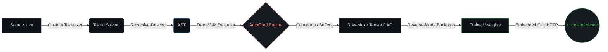

  

  
  
  

---

### `01` // Featured Architecture: [TnsrLang](https://github.com/tenri69/TnsrLang)

A standalone domain-specific language (DSL) and deep learning engine built from scratch in modern **C++17** with **zero external runtime dependencies**.

- **Language Frontend:** Custom tokenizer, recursive-descent AST parser, and lexically scoped tree-walk evaluator.
- **Compute Engine:** Cache-friendly reverse-mode AutoGrad engine using flat contiguous row-major tensor buffers and non-owning DAG captures.
- **Deployment:** End-to-end neural network training (`MNIST`, `XOR`) with an embedded C++ HTTP server for sub-millisecond browser inference.

---

### `02` // Systems & Engineering

| Project / Role | Stack | Architecture & Impact |
| :--- | :--- | :--- |
| **[Production Management System](https://github.com/Anton-Johannesson/krusty-skeleton)** | `Java` `Spark` `MySQL` | Concurrency-safe REST API and 8-table normalized schema using `SERIALIZABLE` transactions for inventory & pallet production. |
| **Bränslekollen**   *Co-Founder & Lead Backend* | `Python` `Pipelines` | Engineered automated data ingestion pipelines and statistical modeling systems from the ground up. |
| **Large-Scale Software Project**   *Test Group Lead* | `Java` `TDD` `CI/CD` | Led quality assurance across an 18-engineer project, architecting 120+ automated Java test suites. |
| **[ABAS Alarm System](https://github.com/tenri69/python-ABAS-alarm-system)** | `Python` `Hardware` | Code-driven intrusion detection system designed for real-time door and window sensor monitoring. |
